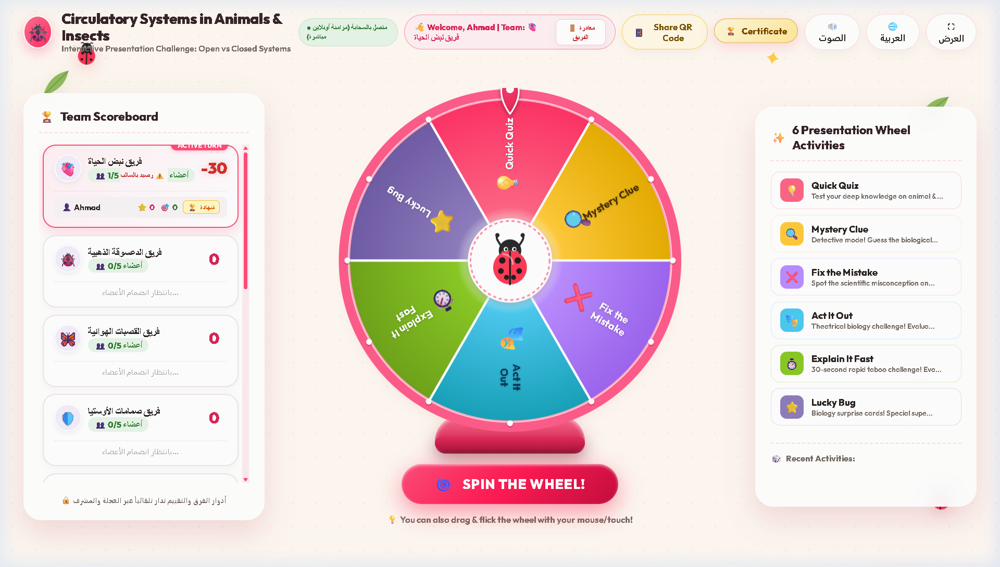

# 🐞 مسابقة الجهاز الدوري في الحيوانات والحشرات | Circulatory Systems Challenge



> **منظومة تعليمية تفاعلية ثلاثية الأبعاد مبنية بنسبة 100% على محتوى العرض التقديمي (15 شريحة)** لمقارنة الأجهزة الدورية المفتوحة والمغلقة، ديناميكا سائل الهيموليمف، القلب الأنبوبي الظهرية وصمامات الأوستيا، القصبات الهوائية في الحشرات، وتطور حجرات القلب في الفقاريات.

---

## 🌟 أبرز ميزات المنظومة (Key Features)

1. **عجلة حظ تفاعلية فيزيائية 60fps**:
   * محاكاة فيزيائية واقعية للقصور الذاتي والاحتكاك والمؤشر الميكانيكي (Flapper Physics).
   * إمكانية السحب والتدوير باللمس على الجوال أو الماوس على الكمبيوتر.
   * مؤثرات صوتية توليدية مدمجة بالكامل عبر Web Audio API واحتفالات Confetti.

2. **6 أنشطة وتحديات علمية مستوحاة من البرزنتيشن**:
   * 💡 **اختبار سريع (Quick Quiz)**: بنك أسئلة علمي متخصص اختيار من متعدد مع عداد زمني.
   * 🔍 **اللغز الغامض (Mystery Clue)**: نمط المحقق الذكي مع 4 خيارات تفاعلية ومؤشر خصم نقاط للمساعدة.
   * ❌ **صحّح الخطأ (Fix the Mistake)**: تفنيد المغالطات العلمية الشائعة واختيار التصحيح الدقيق من بين 4 خيارات.
   * 🎭 **مثّلها بدون كلام (Act It Out)**: تمثيل المفاهيم الحيوية مسرحياً بتحكيم مباشر من المشرف.
   * ⏱️ **اشرحها بسرعة (Explain It Fast)**: تحدي تابو (الكلمات المحظورة) خلال 30 ثانية مع تحكيم المشرف.
   * ⭐ **حشرة الحظ السعيدة (Lucky Bug)**: مفاجآت وبونصات وسرقة نقاط استراتيجية بين الفرق.

3. **جلسات مستقلة وإعادة اتصال ذكية (Session Isolation & Reconnect)**:
   * عزل تام لجلسات المتصفح لكل علامة تبويب وجهاز عبر `sessionStorage` لمنع تداخل أجهزة الطلاب.
   * بمجرد انضمام الطالب لفريق، يختفي زر الانضمام تلقائياً ويظهر ترحيب رسمي باسمه وفريقه:
     `👋 مرحباً، [الاسم] | فريق: [اسم الفريق]`
   * زر **"🚪 مغادرة الفريق"** متاح لإخلاء المقعد بسلاسة عند الرغبة في تبديل الفرق.
   * في حال انضمام الطالب من جهاز جديد أو نافذة جديدة بنفس اسمه ورقم فريقه، يتم **استعادة جلسته وإحصائياته ونقاطه السابقة تلقائياً**.

4. **شهادات إنجاز وتفوق أكاديمية ثنائية اللغة (Official Certificates)**:
   * تصميم فائق الدقة (1200x850 HD) متكيف بالكامل مع لغة الموقع (العربية / English).
   * **المُحكّم الأكاديمي في المنتصف**: ختم ذهبي ثلاثي الأبعاد مجسم 16 نقطة (3D Gold Arbiter Seal).
   * **المشرف الأكاديمي على اليمين**: توقيع المشرف، تاريخ الاعتماد، واللجنة الأكاديمية.
   * **توثيق الأدمن على اليسار**: كود توثيق رقمي فوري (`BIO-ADMIN-[HASH]`) صادر ومعتمد من لوحة التحكم.
   * استخراج فوري بصيغة صورة فائقة الجودة (PNG HD) أو طباعة مستند PDF أفقي.
   * متاحة للطلاب مباشرة من شاشة اللعبة، ومتاحة للأستاذ المشرف عبر لوحة الإدارة لأي طالب أو فريق.

5. **لوحة تحكم وتحكيم مركزية مستقلة وآمنة (Admin Control Center)**:
   * صفحة خاصة ومنفصلة تماماً (`admin.html`) غير ظاهرة ولا يمكن للطلاب الوصول إليها من شاشة اللعبة.
   * نظام أمان مشفر مع حماية ضد محاولات التخمين وقفل مؤقت تلقائي (Brute-Force Lockout).
   * **تجميد اللعبة (Freeze Game)**: إيقاف المسابقة وشل الدوران مؤقتاً بضغطة زر لشرح فقرة أو مراجعة إحصائية، مع شاشة تنبيه متزامنة لدى الطلاب.
   * **تحكيم مباشر**: تقييم التحديات الحية ومنح أو خصم النقاط فورياً.
   * **حظر وفك حظر**: إمكانية حظر فريق كامل أو حظر طالب محدد في حال المخالفة السلوكية أو التلاعب.
   * **تصفير وإعادة تعيين**: تصفير كل فريق على حدة دون التأثير على بقية الفرق المتنافسة.
   * **تحكم بالدوران عن بُعد**: إطلاق الدوران أو توجيه العجلة لنشاط معين عبر الإنترنت.

6. **مزامنة عالمية حية وفورية عبر الإنترنت (Global Real-time Cloud Sync)**:
   * اتصال سحابي فوري عبر WebSockets يربط هاتف المشرف وشاشة العرض وهواتف جميع المتسابقين أينما كانوا بدون أي تكلفة أو سيرفرات وسيطة.

---

## 👥 الفرق الـ 10 المتنافسة وأكواد الدعوة (Competition Teams)

صُممت الفرق العشرة لتكون محايدة ومحفزة للأولاد والبنات معاً، وبسعة قصوى محكمة (**5 أعضاء فقط لكل فريق**) لمنع التكدس:

| # | الفريق | الرمز | كود الدعوة | السعة | المفهوم العلمي في العرض التقديمي |
|:---:|:---|:---:|:---:|:---:|:---|
| **1** | **فريق نبض الحياة** | 🫀 | `101` | 5 | انقباض وانبساط القلب والدورة الدموية |
| **2** | **فريق الدعسوقة الذهبية** | 🐞 | `102` | 5 | نموذج الحشرات وكفاءة الأجهزة الدورية |
| **3** | **فريق القصبات الهوائية** | 🦋 | `103` | 5 | شبكة التبادل الغازي التنفسي (Tracheae) في الحشرات |
| **4** | **فريق صمامات الأوستيا** | 🛡️ | `104` | 5 | صمامات القلب الظهرية أحادية الاتجاه (Ostia) |
| **5** | **فريق النحل النشط** | 🐝 | `105` | 5 | الحشرات الطائرة والتكيف الفسيولوجي عالي الطاقة |
| **6** | **فريق أبطال الهيموليمف** | 💎 | `106` | 5 | السائل الدوري المفتوح الناقل للغذاء والفضلات |
| **7** | **فريق الوعاء الظهري** | ⚡ | `107` | 5 | القلب الأنبوبي الظهرية والأورطة الأمامية |
| **8** | **فريق فرسان الدورة المزدوجة** | 🦅 | `108` | 5 | تطور القلب رباعي الحجرات والدورة الرئوية الجهازية |
| **9** | **فريق الشعيرات الدقيقة** | 🔬 | `109` | 5 | شبكة التبادل المجهري المغلقة بين الأنسجة والدم |
| **10** | **فريق حماة الخلية** | 🌟 | `110` | 5 | خلايا المناعة الدفاعية السابحة في السائل الدوري |

---

## 🎮 دليل الاستخدام (User Guide)

### 1. شاشة المسابقة والعرض الرئيسية (`index.html`):
1. افتح صفحة المسابقة على شاشة القاعة أو أجهزة المتسابقين.
2. يضغط المتسابق على زر **"انضم لفريقك"**، ويدخل اسمه وكود فريقه المخصص.
3. يتحول الزر تلقائياً إلى شارة ترحيبية رسمية باسم الطالب وفريقه.
4. يدوّر المتسابق العجلة بلمس الشاشة أو النقر على زر الدوران، وتظهر نافذة النشاط مع احتساب النقاط التلقائي.
5. يمكن للمتسابق أو فريقه استخراج شهادة التكريم الرسمية في أي وقت بالضغط على **"🏆 شهادة الإنجاز"**.

### 2. لوحة تحكم المشرف (`admin.html`):
1. افتح صفحة المشرف من هاتف المحاضر أو لابتوب الإدارة.
2. أدخل الرمز السري الخاص بالمشرف لتسجيل الدخول الآمن.
3. ستتمكن من:
   * تجميد اللعبة أو استئنافها فوراً بنقرة واحدة.
   * تحكيم الأنشطة المسرحية والشفهية ورصد درجاتها.
   * تعديل نقاط أي فريق أو تصفير إحصائياته.
   * إصدار وتوثيق وطباعة شهادات التكريم لأي طالب أو فريق مع كود الاعتماد الرقمي.

---

## 🚀 النشر والاستضافة المجانية مدى الحياة (Deployment)

### النشر عبر GitHub Pages:
1. اذهب لمستودعك على GitHub: `https://github.com/toolpro2030/biology-game`
2. اضغط على **Settings** > **Pages**.
3. اختر مصدر النشر `Deploy from a branch`، واختر الفرع `main` والمجلد `/(root)`، ثم اضغط **Save**.
4. رابط المسابقة المباشر:
   ```
   https://toolpro2030.github.io/biology-game/
   ```

### النشر عبر Vercel:
* المشروع مجهز بملف ضبط `vercel.json` ليعمل تلقائياً عند ربط المستودع بمنصة [Vercel](https://vercel.com) مع توفير شهادة أمان SSL ونطاق فائق السرعة عالمياً.

---

## 🔒 معايير الأمان والخصوصية (Security & Integrity)

* **خلو واجهة المتسابقين من روابط الإدارة**: واجهة اللاعب نظيفة وخالية من أي أزرار أو روابط تشير لصفحة الأدمن منعاً للعبث.
* **تأمين التشفير ومقاومة التخمين**: تعتمد لوحة المشرف على تشفير تجزئة أمني مع ملح (Salted Hash) بدلاً من المقارنات النصية الصريحة.
* **نظام الإغلاق الأمني التلقائي**: بعد عدة محاولات إدخال خاطئة في لوحة الإدارة، يتم قفل لوحة المفاتيح تلقائياً لمدة زمنية تصاعدية لحماية النظام.
* **عزل الجلسات**: استخدام التخزين المعزول لكل لسان متصفح يحول دون انتحال هوية متسابق من جهاز أو نافذة أخرى.